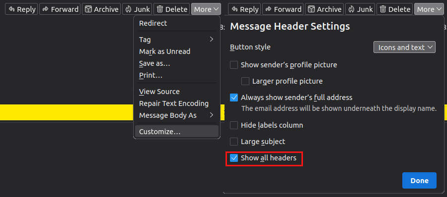

# ol-thunderbird
This package adds a new org-link-type: thunderbird to [GNU Emacs](https://www.gnu.org/software/emacs/) org-mode.

This allows to link related emails in org-headers. It's for everyone
who hasn't setup [mu4e](https://github.com/emacsmirror/mu4e).

It's not a integration of [Thunderbird](https://www.thunderbird.net/) into [org-mode](https://orgmode.org/).

To open the correct email within Thunderbird the message-id is used.

Beaware the copyed message-id is supplied to `shell-command`, which
allows for arbitrary code execution if malicous ids are supplied.

## Getting started
### Installation

Currently, not available on [MELPA](https://melpa.org/).

```emacs-lisp
(use-package ol-thunderbird
  :straight (ol-thunderbird :type git :host github :repo "lordnik22/ol-thunderbird"))
```

Alternatively you can clone this project and add it to the load-path
in your init-file:
```
(add-to-list 'load-path "~/.emacs.d/elisp/ol-thunderbird")
(require 'ol-thunderbird)
```

### Your first link to thunderbird in org-mode

1. Open the email you want to link in Thunderbird
2. (If not already done) Display all headers (see image)
3. Copy Message-Id by right-click and choose `Copy Message-ID`
4. Switch to your org-file opened in Emacs
5. `C-c C-l thunderbird ENT ENT` (`org-insert-link`)
6. Test your link

Context to step 5: If the package is installed correcly there should
be the new link-type: `thunderbird`. With `ENT` we can choose an id
with completion showing candidates from the kill-ring. If you just
copied the message-id from Thunderbird then the first candidate should
be preselected candidate (IDO). With the second `ENT` we confirm this
candidate.

Ah and did I mention, I use IDO...


